<div align="center">

# GyMetrics · GyMc

**Sistema desktop de controle de acesso para academias**

Catraca por CPF ou código · cadastro de alunos e planos · mensalidades · relatórios de frequência


IF Goiano · Campus Cristalina<br>
Curso Técnico em Informática Integrado ao Ensino Médio · Disciplina **Desenvolvimento para Desktop**

</div>

---

## Sumário

1. [Sobre o projeto](#1-sobre-o-projeto)
2. [Equipe](#2-equipe)
3. [Telas](#3-telas)
4. [Funcionalidades e casos de uso](#4-funcionalidades-e-casos-de-uso)
5. [Rastreabilidade dos requisitos](#5-rastreabilidade-dos-requisitos)
6. [Regras de negócio implementadas](#6-regras-de-negócio-implementadas)
7. [Arquitetura](#7-arquitetura)
8. [Diagrama de classes](#8-diagrama-de-classes)
9. [Modelo de dados](#9-modelo-de-dados)
10. [Como executar](#10-como-executar)
11. [Primeiro acesso](#11-primeiro-acesso)
12. [Estrutura do repositório](#12-estrutura-do-repositório)
13. [Diagramas UML](#13-diagramas-uml)
14. [Limitações conhecidas e próximos passos](#14-limitações-conhecidas-e-próximos-passos)

---

## 1. Sobre o projeto

O **GyMetrics** automatiza a entrada e a saída de alunos de uma academia. Na recepção, o aluno informa o **CPF ou o código numérico de acesso** e o sistema decide na hora se libera ou bloqueia a passagem. A decisão considera:

- a **situação do cadastro**: dados obrigatórios preenchidos;
- a **situação financeira**: mensalidade em dia;
- o **bloqueio manual** feito pela recepção.

Cada movimentação fica registrada com data e hora. O sistema também gera indicadores do dia, avisos de vencimento, a listagem financeira do mês e relatórios de frequência exportáveis em CSV.

| | |
|---|---|
| **Problema** | Controle manual de entrada, sem histórico confiável e sem saber quem está com a mensalidade vencida. |
| **Solução** | Aplicação desktop com validação automática na catraca e registro de todos os acessos. |
| **Usuários** | Recepcionista (operação do dia a dia) e Administrador (planos e relatórios). |
| **Persistência** | Banco SQLite local (`gymetrics.db`), criado automaticamente na primeira execução. |

## 2. Equipe

| Integrante | Papel |
|---|---|
| Alexsander dos Santos Dias | Coordenador da equipe |
| Bruno Felipe Cândido da Silva | Desenvolvedor |
| Gustavo Fernandes Vieira da Silva | Desenvolvedor |
| Gustavo Rocha dos Santos | Desenvolvedor |
| Isaque Gonçalves Gomes | Desenvolvedor |
| João Eduardo Jorge dos Santos | Desenvolvedor |
| Moizes de Jesus Sousa | Desenvolvedor |

**Gerente do projeto:** professor responsável pela disciplina.

## 3. Telas

A interface segue os protótipos da seção **4.1 Prototipação** do documento de modelagem: fundo branco, campos cinza com o texto centralizado, botões cinza, títulos em caixa alta e tabelas com cabeçalho cinza.

| Login (CSU03) | Painel principal (RF08, RF12, RF19, RF20) |
|---|---|
| 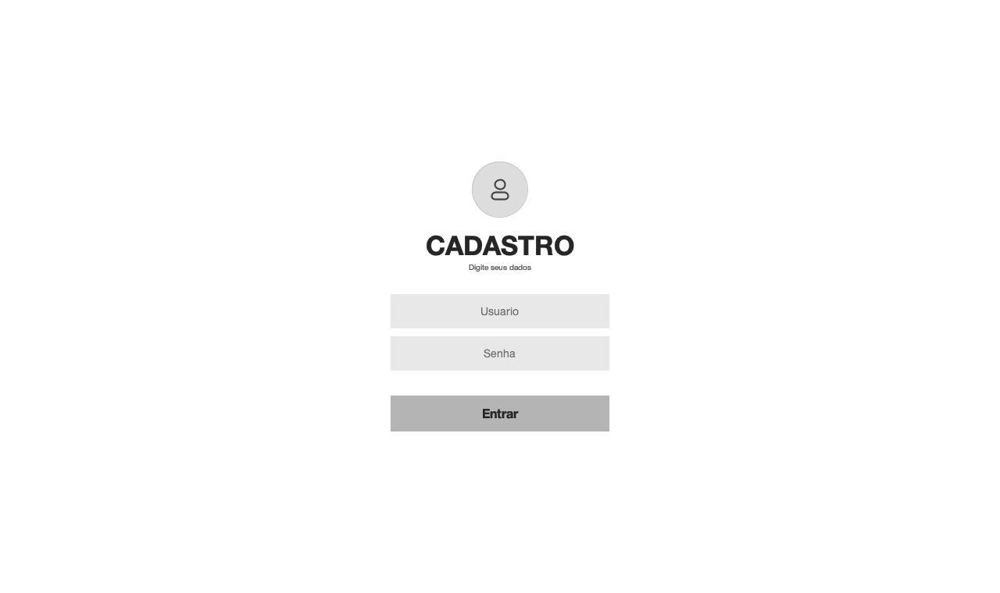 | 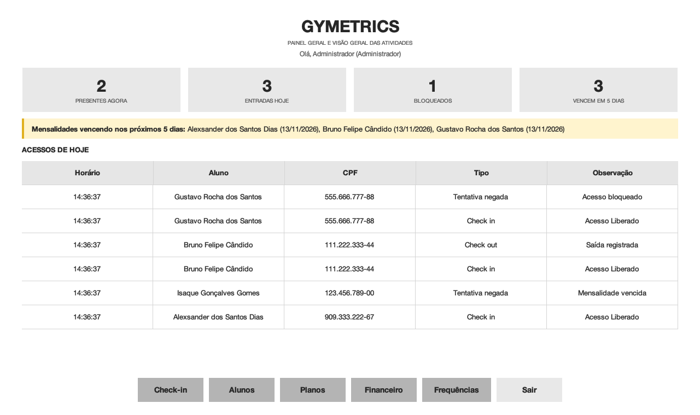 |

| Alunos cadastrados (CSU01, 02, 05, 07) | Check-in (CSU08) |
|---|---|
| 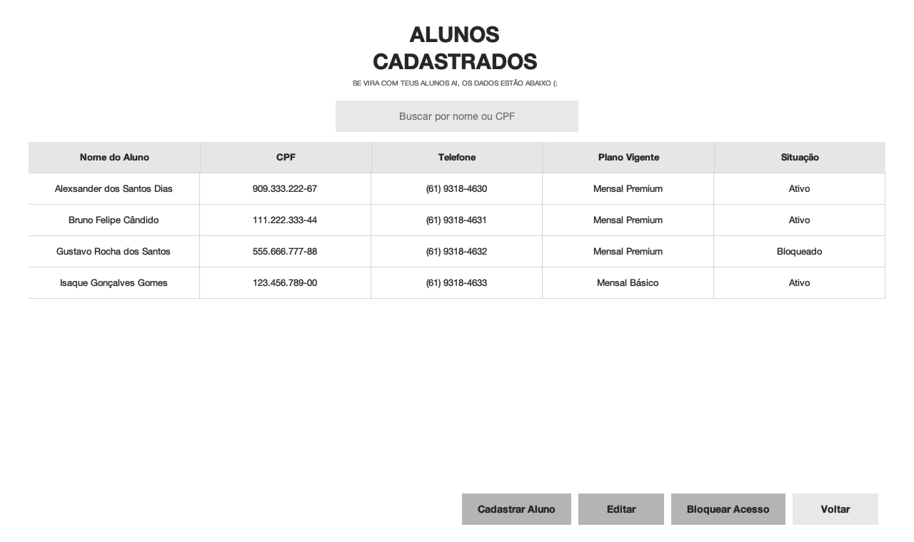 | 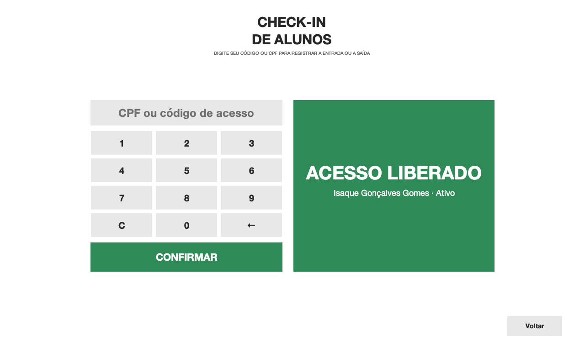 |

| Financeiro (CSU04) | Planos (CSU06) |
|---|---|
| 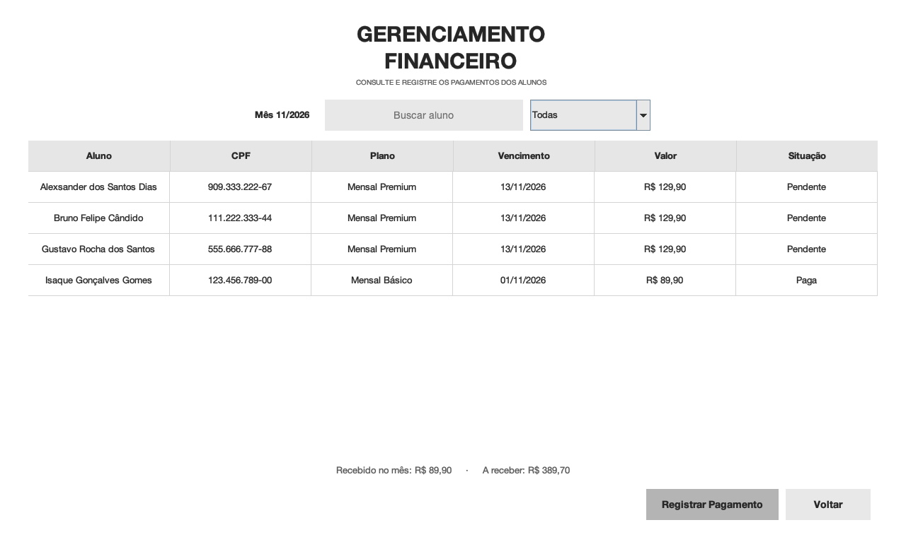 | 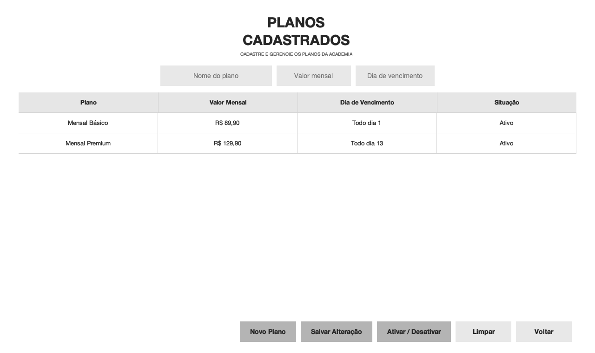 |

| Relatório de frequência (CSU09, CSU10) |
|---|
| 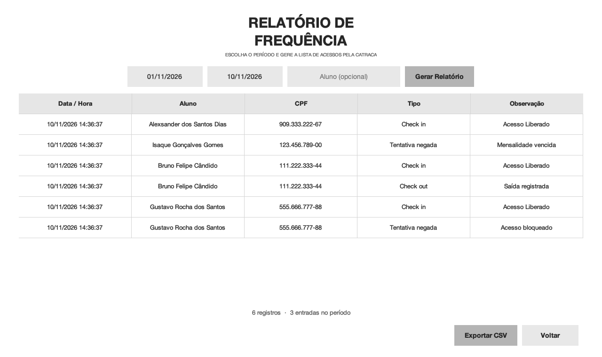 |

> As capturas usam dados de exemplo.

## 4. Funcionalidades e casos de uso

| ID | Caso de uso | Ator | Onde está no código |
|---|---|---|---|
| CSU01 | Cadastrar Aluno | Recepcionista | `TelaGerenciamentoAlunos` → `AlunoDAO.salvar` |
| CSU02 | Buscar Aluno (filtro em tempo real por nome ou CPF) | Recepcionista | `TelaGerenciamentoAlunos` → `AlunoDAO.buscar` |
| CSU03 | Realizar Login | Recepcionista / Administrador | `TelaLogin` → `UsuarioDAO.autenticar` |
| CSU04 | Registrar Pagamento | Recepcionista | `TelaGerenciamentoFinanceiro` → `PagamentoDAO.salvar` |
| CSU05 | Editar Dados do Aluno | Recepcionista | `TelaGerenciamentoAlunos` → `AlunoDAO.atualizar` |
| CSU06 | Cadastrar Plano | Administrador | `TelaGerenciamentoPlanos` → `PlanoDAO.salvar / atualizar` |
| CSU07 | Bloquear Acesso do Aluno (com motivo) | Recepcionista | `TelaGerenciamentoAlunos` → `AlunoDAO.bloquear` |
| CSU08 | Realizar Check-in (entrada e saída no mesmo botão) | Recepcionista | `TelaCheckin` → `RegistroAcessoDAO` |
| CSU09 | Gerar Relatório de Frequência por período | Administrador | `TelaRelatorios` → `RegistroAcessoDAO.listarPorPeriodo` |
| CSU10 | Exportar Frequências em CSV | Recepcionista | `TelaRelatorios` → `ExportadorCSV` |

**Check-in com botão único:** a recepcionista digita o CPF ou o código e clica em **Confirmar**, ou aperta Enter.

- Se o aluno **já entrou hoje e ainda não saiu**, o sistema registra a **saída**.
- Caso contrário, o sistema **valida e registra a entrada**.

Funciona como uma catraca: não precisa escolher entre "entrada" e "saída".

## 5. Rastreabilidade dos requisitos

### Requisitos funcionais

| RF | Descrição resumida | Situação | Implementação |
|---|---|:---:|---|
| RF01 | Cadastro de dados pessoais do aluno | ✅ | `Aluno`, `AlunoDAO`, formulário em `TelaGerenciamentoAlunos` |
| RF02 | Validar entrada digitando CPF ou nome | ✅ | `TelaCheckin` (CPF/código) e busca por nome em `TelaGerenciamentoAlunos` |
| RF03 | Aviso no check-in de aluno bloqueado | ✅ | `RegistroAcesso.entrada` → "Acesso bloqueado" |
| RF04 | Aviso de cadastro incompleto no check-in | ✅ | `Aluno.cadastroCompleto` → "Cadastro incompleto" |
| RF05 | Mensagem "Acesso Liberado" em destaque | ✅ | Painel verde com fonte de 44 pt em `TelaCheckin` |
| RF06 | Gravar data e hora de cada check-in e check-out | ✅ | Tabela `registros_acesso` |
| RF07 | Exportar frequências em CSV | ✅ | `ExportadorCSV`, botão "Exportar CSV" |
| RF08 | Quantidade de alunos presentes no dia | ✅ | `RegistroAcessoDAO.contarPresentes` |
| RF09 | Relatório de frequência por período | ✅ | `TelaRelatorios` |
| RF10 | Login com perfis Recepcionista e Administrador | ✅ | `UsuarioDAO.autenticar`, `GymSingleton.isAdmin` |
| RF11 | Planos de mensalidade associados ao aluno | ✅ | `Plano`, `PlanoDAO`, combo "Plano" no cadastro do aluno |
| RF12 | Aviso de mensalidades vencendo em 5 dias | ✅ | `MensalidadeDAO.vencendo`, faixa amarela no painel principal |
| RF13 | Código numérico de acesso por aluno | ✅ | Campo `codigo_acesso` (único, só dígitos) |
| RF14 | Liberar/bloquear pela situação (ativo, inadimplente, bloqueado) | ✅ | `Aluno.podeAcessar` |
| RF15 | Histórico de acessos por aluno e período | ✅ | Filtro "Aluno" em `TelaRelatorios` |
| RF16 | Bloqueio manual com registro do motivo | ✅ | Tabela `bloqueios_acesso` (motivo, data e usuário) |
| RF17 | Listagem financeira mensal | ✅ | `TelaGerenciamentoFinanceiro` com totais recebido / a receber |
| RF18 | Registrar tentativa de acesso com mensalidade vencida | ✅ | `TENTATIVA_NEGADA` com observação "Mensalidade vencida" |
| RF19 | Lista diária de acessos em tabela | ✅ | Tabela "Acessos de hoje" no painel principal |
| RF20 | Tela principal com indicadores | ✅ | Quatro indicadores em `TelaPrincipal` |

### Requisitos não funcionais

| RNF | Descrição resumida | Situação | Como foi atendido |
|---|---|:---:|---|
| RNF06 | Qualquer função em até 10 cliques | ✅ | Todas as telas ficam a 1 clique do painel principal |
| RNF07 | Mensagens de erro claras, sem termos técnicos | ✅ | `GymSingleton.showErro` traduz erros (ex.: CPF duplicado) |
| RNF08 | "Acesso Liberado" legível a 1 metro | ✅ | Fonte de 44 pt, em negrito, sobre fundo colorido |
| RNF09 | Aviso de vencimentos na abertura | ✅ | Faixa amarela exibida ao entrar no painel |
| RNF10 | Operável só com mouse e teclado | ✅ | Enter confirma login e check-in; teclado numérico na tela |
| RNF11 | Login individual com senha | ✅ | Tabela `usuarios` |
| RNF12 | Bloquear usuário após 10 tentativas erradas | ✅ | `UsuarioDAO` desativa o login na 10ª tentativa |
| RNF13 | Mostrar só as funções do perfil logado | ✅ | Botão "Planos" oculto para recepcionista; tela bloqueada |
| RNF14 | Senha com no mínimo 6 caracteres | ✅ | `Usuario.validar` |
| RNF15 | Log de todas as ações com usuário | ⚠️ Parcial | Acessos e bloqueios são registrados; as demais ações ainda não |
| RNF19 | Persistência exclusiva em SQLite | ✅ | `sqlite-jdbc` em `lib/` |
| RNF20 | Suportar 10.000 alunos | ✅ | Buscas por CPF e código usam índices `UNIQUE` |

## 6. Regras de negócio implementadas

**Situação do aluno**

| Situação | Pode entrar? | Quando acontece |
|---|:---:|---|
| `ATIVO` | ✅ (com cadastro completo) | Ao cadastrar e ao pagar a mensalidade |
| `INADIMPLENTE` | ❌ | Mensalidade passou do vencimento sem pagamento |
| `BLOQUEADO` | ❌ | Bloqueio manual com motivo registrado |

**Mensalidades**

- Na abertura do sistema e das telas Principal e Financeiro, é gerada a mensalidade do mês para cada aluno que tem plano.
- O vencimento cai no dia escolhido no plano. Em meses mais curtos, vai para o último dia do mês.
- A operação é idempotente: rodar de novo não duplica mensalidades.
- Mensalidade `PENDENTE` com vencimento no passado vira `VENCIDA`, e o aluno passa para `INADIMPLENTE`.

**Pagamento:** gravar o pagamento, quitar a mensalidade e reativar o aluno acontecem numa única **transação**. Ou tudo é salvo, ou nada é.

**Cadastro completo:** nome, CPF, endereço, telefone e data de nascimento. O CPF e o código de acesso são únicos.

## 7. Arquitetura

O sistema é organizado em camadas, uma por pacote:

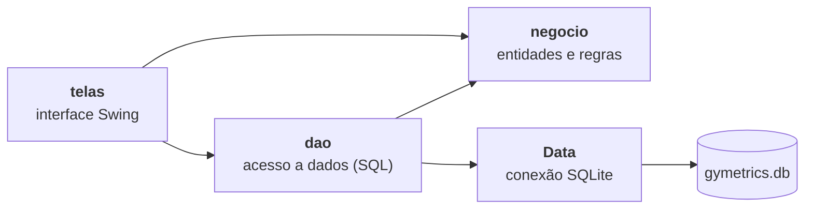

| Pacote | Responsabilidade |
|---|---|
| `br.com.gymetrics` | `Main` (inicialização), `GymSingleton` (navegação entre telas, sessão do usuário e acesso aos DAOs), `Data` (conexão, transações e criação das tabelas) |
| `br.com.gymetrics.negocio` | Entidades com suas regras: `Aluno`, `Plano`, `Mensalidade`, `Pagamento`, `RegistroAcesso`, `Usuario` |
| `br.com.gymetrics.dao` | Um DAO por entidade. Todo SQL usa `PreparedStatement`, o que protege contra SQL injection |
| `br.com.gymetrics.telas` | Telas Swing (`CardLayout`), o estilo visual compartilhado (`Estilo`) e a interface `Atualizavel`, que recarrega os dados ao abrir uma tela |
| `br.com.gymetrics.util` | `ExportadorCSV` |

**Padrões utilizados**

- **Singleton:** `GymSingleton`, ponto central da aplicação.
- **DAO:** separa o SQL das regras de negócio.
- **Callback funcional:** `SetupExecCallback` e `RowMapper` preenchem os parâmetros e convertem as linhas do banco.
- **Template de estilo:** `Estilo` concentra cores, fontes, campos, botões e tabelas, então todas as telas ficam com o mesmo visual.

## 8. Diagrama de classes

### Sistema completo

Todas as classes do sistema, agrupadas por pacote: entidades (`negocio`), controle (`dao`), infraestrutura (`gymetrics`), utilitárias (`util`) e fronteira (`telas`). Getters e setters foram omitidos para facilitar a leitura.

```mermaid
%% 4.3.1 / 4.3.2 Diagrama de Classes completo (entidades, controle/DAO, utilitárias e fronteira)
%% Getters e setters das entidades foram omitidos para legibilidade.
classDiagram
    direction TB

    namespace gymetrics {
        class Main {
            +main(String[] args)$
        }
        class GymSingleton {
            <<singleton>>
            -GymSingleton instance$
            -CardLayout telasLayout
            -Map~String,Component~ porNome
            -Data data
            -Usuario usuarioLogado
            +getInstance()$ GymSingleton
            +showTela(String nome)
            +getUsuarioLogado() Usuario
            +setUsuarioLogado(Usuario u)
            +isAdmin() boolean
            +sair()
            +alunos() AlunoDAO
            +planos() PlanoDAO
            +usuarios() UsuarioDAO
            +pagamentos() PagamentoDAO
            +mensalidades() MensalidadeDAO
            +acessos() RegistroAcessoDAO
            +showMsg(String texto)
            +showErro(Exception e)
            +executar(Acao acao) boolean
            +takeFrame() JPanel
            -criarUsuariosIniciais()
        }
        class Data {
            -Connection mConnection
            +open(String arquivo)
            +exec(String sql, SetupExecCallback setup, RowMapper~T~ mapper) List~T~
            +insert(String sql, SetupExecCallback setup) int
            +update(String sql, SetupExecCallback setup) int
            +run(String sql)
            +transacao(SqlAction acao)
            +criarTabelas()
            +suicide()
        }
        class SetupExecCallback {
            <<interface>>
            +setupExecParams(PreparedStatement ps)
        }
    }

    namespace negocio {
        class Aluno {
            -int id
            -String nome
            -String cpf
            -String endereco
            -String telefone
            -LocalDate dataNascimento
            -String codigoAcesso
            -Status status
            -Plano plano
            +cadastroCompleto() boolean
            +podeAcessar() boolean
            +validar()
        }
        class Plano {
            -int id
            -String nome
            -BigDecimal valorMensal
            -int diaVencimento
            -boolean ativo
            +validar()
        }
        class Mensalidade {
            -int id
            -Aluno aluno
            -LocalDate vencimento
            -BigDecimal valor
            -Status status
        }
        class Pagamento {
            -int id
            -Mensalidade mensalidade
            -YearMonth mesReferencia
            -BigDecimal valorPago
            -LocalDateTime dataPagamento
            +validar()
        }
        class RegistroAcesso {
            -int id
            -Aluno aluno
            -LocalDateTime dataHora
            -Tipo tipo
            -String observacao
            +entrada(Aluno a)$ RegistroAcesso
            +saida(Aluno a)$ RegistroAcesso
        }
        class Usuario {
            -int id
            -String login
            -String senha
            -String nome
            -String perfil
            -boolean ativo
            +validar()
        }
    }

    namespace dao {
        class AlunoDAO {
            -Data db
            +salvar(Aluno a)
            +atualizar(Aluno a)
            +buscar(String termo) List~Aluno~
            +buscarPorCpfOuCodigo(String valor) Aluno
            +contar(Status status) int
            +bloquear(Aluno a, String motivo, Usuario responsavel)
        }
        class PlanoDAO {
            -Data db
            +salvar(Plano p)
            +atualizar(Plano p)
            +listar() List~Plano~
        }
        class MensalidadeDAO {
            -Data db
            +prepararMes(LocalDate hoje)
            +listarDoMes(YearMonth mes) List~Mensalidade~
            +vencendo(LocalDate hoje, int dias) List~Mensalidade~
        }
        class PagamentoDAO {
            -Data db
            +salvar(Pagamento p)
        }
        class RegistroAcessoDAO {
            -Data db
            +salvar(RegistroAcesso r)
            +registrarEntrada(Aluno a) RegistroAcesso
            +registrarSaida(Aluno a) RegistroAcesso
            +estaPresente(Aluno a, LocalDate dia) boolean
            +contarEntradas(LocalDate dia) int
            +contarPresentes(LocalDate dia) int
            +listarPorPeriodo(LocalDate inicio, LocalDate fim) List~RegistroAcesso~
        }
        class UsuarioDAO {
            -int MAX_TENTATIVAS$
            -Data db
            -Map~String,Integer~ tentativas
            +salvar(Usuario u)
            +contar() int
            +estaBloqueado(String login) boolean
            +autenticar(String login, String senha) Usuario
        }
    }

    namespace util {
        class ExportadorCSV {
            <<utility>>
            +exportarAcessos(List~RegistroAcesso~ lista, Path arquivo)$
        }
    }

    namespace telas {
        class Atualizavel {
            <<interface>>
            +atualizar()
        }
        class Estilo {
            <<utility>>
            +pagina()$ JPanel
            +cabecalho(String titulo, String subtitulo)$ JPanel
            +botao(String texto, Runnable acao)$ Botao
            +tabela(String... colunas)$ JTable
            +formulario(...)$ boolean
        }
        class TelaLogin {
            -entrar()
        }
        class TelaPrincipal
        class TelaCheckin {
            -confirmar()
        }
        class TelaGerenciamentoAlunos {
            -cadastrar()
            -editar()
            -bloquear()
        }
        class TelaGerenciamentoPlanos {
            -cadastrar()
            -editar()
            -alternar()
        }
        class TelaGerenciamentoFinanceiro {
            -registrarPagamento()
        }
        class TelaRelatorios {
            -gerar()
            -exportar()
        }
        class TelaDebug
    }

    %% associações entre entidades
    Aluno "0..*" --> "0..1" Plano : assina
    Mensalidade "0..*" --> "1" Aluno : cobra
    Pagamento "0..*" --> "1" Mensalidade : quita
    RegistroAcesso "0..*" --> "0..1" Aluno : registra

    %% infraestrutura
    Main ..> GymSingleton : getInstance()
    GymSingleton *-- Data
    GymSingleton *-- AlunoDAO
    GymSingleton *-- PlanoDAO
    GymSingleton *-- MensalidadeDAO
    GymSingleton *-- PagamentoDAO
    GymSingleton *-- RegistroAcessoDAO
    GymSingleton *-- UsuarioDAO
    GymSingleton --> Usuario : usuarioLogado
    GymSingleton o-- Atualizavel : telas
    Data ..> SetupExecCallback

    %% DAOs persistem as entidades (o uso de Data aparece no atributo -Data db)
    AlunoDAO ..> Aluno
    PlanoDAO ..> Plano
    MensalidadeDAO ..> Mensalidade
    PagamentoDAO ..> Pagamento
    RegistroAcessoDAO ..> RegistroAcesso
    UsuarioDAO ..> Usuario
    ExportadorCSV ..> RegistroAcesso

    %% telas
    Atualizavel <|.. TelaLogin
    Atualizavel <|.. TelaPrincipal
    Atualizavel <|.. TelaCheckin
    Atualizavel <|.. TelaGerenciamentoAlunos
    Atualizavel <|.. TelaGerenciamentoPlanos
    Atualizavel <|.. TelaGerenciamentoFinanceiro
    Atualizavel <|.. TelaRelatorios
    TelaRelatorios ..> ExportadorCSV
```

> Versão em imagem: [`docs/diagramas/img/14-classes-sistema.png`](docs/diagramas/img/14-classes-sistema.png) · [SVG](docs/diagramas/img/14-classes-sistema.svg)

### Classes de domínio (detalhe)

As entidades do pacote `negocio`, suas multiplicidades e os enums de situação:

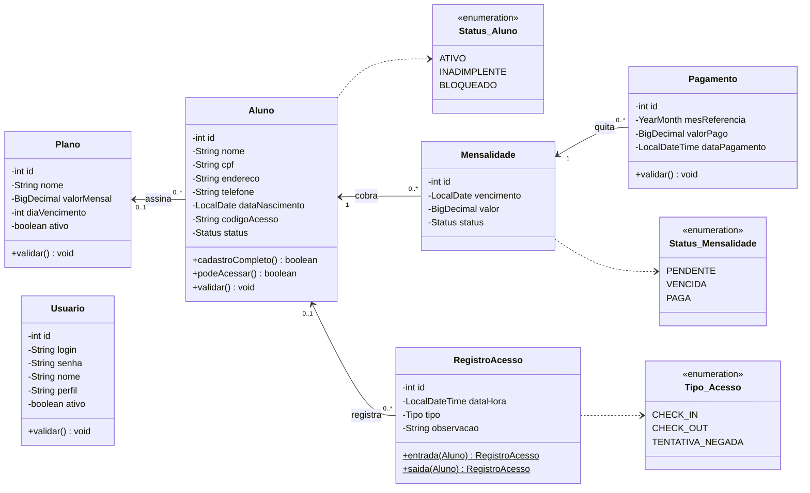

## 9. Modelo de dados

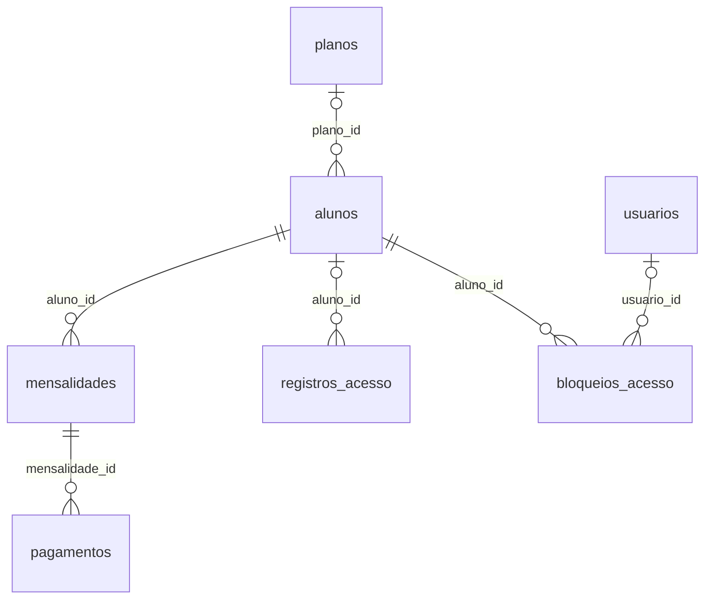

As tabelas são criadas automaticamente por `Data.criarTabelas()`. A especificação completa, com colunas e restrições, está em [`docs/diagramas/13-mrn.mmd`](docs/diagramas/13-mrn.mmd).

## 10. Como executar

**Pré-requisitos:** JDK **21 ou superior**. O driver SQLite já vem em `lib/`.

### Pelo Eclipse

1. `File → Import → Existing Projects into Workspace` e selecione a pasta do projeto.
2. Confira se o JRE do projeto é **JavaSE-21** ou mais novo.
3. `Project → Clean` para apagar compilações antigas.
4. Clique com o botão direito em `src/br/com/gymetrics/Main.java` → `Run As → Java Application`.

### Pela linha de comando

```bash
# compilar
javac -encoding UTF-8 -d bin -p lib $(find src -name "*.java")

# executar (no Windows, troque ":" por ";" no -p)
java --enable-native-access=ALL-UNNAMED -p bin:lib --add-modules ALL-MODULE-PATH -m Gymetrics/br.com.gymetrics.Main
```

O banco `gymetrics.db` é criado na pasta em que o programa é executado.

## 11. Primeiro acesso

Num banco novo, o sistema cria dois usuários:

| Perfil | Usuário | Senha |
|---|---|---|
| Administrador | `admin` | `admin123` |
| Recepcionista | `recepcao` | `recepcao123` |

**Roteiro sugerido para a demonstração**

1. Entre como `admin` e cadastre um plano em **Planos**.
2. Em **Alunos**, cadastre um aluno com um código de acesso e vincule o plano.
3. Em **Check-in**, digite o código e confirme: **ACESSO LIBERADO**. Confirme de novo: **SAÍDA REGISTRADA**.
4. Em **Alunos**, bloqueie o aluno e tente o check-in de novo: **ACESSO BLOQUEADO**.
5. Veja os acessos em **Frequências** e exporte o CSV.
6. Em **Financeiro**, registre o pagamento da mensalidade.

## 12. Estrutura do repositório

```
Gymetrics/
├── src/
│   ├── module-info.java
│   └── br/com/gymetrics/
│       ├── Main.java, GymSingleton.java, Data.java, SetupExecCallback.java
│       ├── negocio/    Aluno, Plano, Mensalidade, Pagamento, RegistroAcesso, Usuario
│       ├── dao/        AlunoDAO, PlanoDAO, MensalidadeDAO, PagamentoDAO, RegistroAcessoDAO, UsuarioDAO
│       ├── telas/      TelaLogin, TelaPrincipal, TelaCheckin, TelaGerenciamento*, TelaRelatorios, Estilo
│       └── util/       ExportadorCSV
├── lib/                sqlite-jdbc
└── docs/
    ├── diagramas/      fontes Mermaid (.mmd), imagens em img/ e script gerar.sh
    └── telas/          capturas de tela usadas neste README
```

## 13. Diagramas UML

Todos os diagramas do documento de modelagem foram feitos em **Mermaid**, a partir do código real. Ficam versionados junto com o projeto em [`docs/diagramas/`](docs/diagramas/README.md), com o source (`.mmd`) e as imagens (PNG e SVG).

| Seção do documento | Diagrama |
|---|---|
| 3.2.2 | [Atores](docs/diagramas/img/01-atores.png) |
| 3.2.3 / 3.2.5 | [Casos de uso em pacotes](docs/diagramas/img/02-casos-de-uso.png) |
| 3.3.1 / 4.3.1 | [Classes de domínio](docs/diagramas/img/03-classes-dominio.png) · [Robustez do check-in](docs/diagramas/img/04-robustez-checkin.png) |
| 4.3.1 / 4.3.2 | [Classes do sistema completo](docs/diagramas/img/14-classes-sistema.png) |
| 4.2.1 | Sequência: [Login](docs/diagramas/img/05-sequencia-login.png) · [Check-in](docs/diagramas/img/06-sequencia-checkin.png) · [Pagamento](docs/diagramas/img/07-sequencia-pagamento.png) |
| 4.4.1 | Estados: [Aluno](docs/diagramas/img/08-estados-aluno.png) · [Mensalidade](docs/diagramas/img/09-estados-mensalidade.png) |
| 4.5.3 | [Atividades da catraca](docs/diagramas/img/10-atividade-checkin.png) |
| 4.6.1 | [Pacotes](docs/diagramas/img/11-pacotes.png) |
| 4.6.2 / 4.6.3 | [Componentes e implantação](docs/diagramas/img/12-implantacao.png) |
| 4.7.2 | [Modelo relacional (MRN)](docs/diagramas/img/13-mrn.png) |

Para gerar as imagens de novo depois de editar um `.mmd`: `docs/diagramas/gerar.sh` (requer o [Mermaid CLI](https://github.com/mermaid-js/mermaid-cli)).

## 14. Limitações conhecidas e próximos passos

- **Senhas em texto puro:** o próximo passo é guardar só o hash (por exemplo, BCrypt).
- **RNF15:** registrar em log todas as ações (cadastros, edições e pagamentos) com o usuário responsável. Hoje só acessos e bloqueios guardam essa informação.
- **Cadastro de usuários pela interface:** hoje existem apenas os dois usuários criados no primeiro acesso.
- **Testes automatizados com JUnit** cobrindo os DAOs e as regras de acesso.
- **Integração com catraca física**, lendo o código direto do hardware.

---

<div align="center">
Projeto acadêmico · IF Goiano – Campus Cristalina · 2026
</div>
