# Diagramas do GyMetrics

Fonte em Mermaid (`.mmd`) de cada diagrama do documento *Modelagem do Desenvolvimento do Sistema de Software*.
Os números das seções batem com o sumário do documento. As imagens prontas para colar no documento ficam em `img/` (PNG e SVG).

Para gerar as imagens de novo depois de editar um `.mmd`: `./gerar.sh`

O GitHub desenha os blocos `mermaid` abaixo direto na página.

## 3.2.2 Diagrama de Casos de Uso (somente atores)

Fonte: [`01-atores.mmd`](01-atores.mmd) · Imagem: [`img/01-atores.png`](img/01-atores.png)

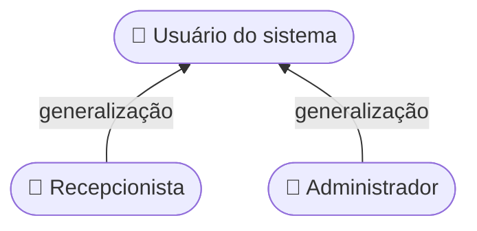

## 3.2.3 / 3.2.5 Casos de Uso primários e Arquitetura em Pacotes

Fonte: [`02-casos-de-uso.mmd`](02-casos-de-uso.mmd) · Imagem: [`img/02-casos-de-uso.png`](img/02-casos-de-uso.png)

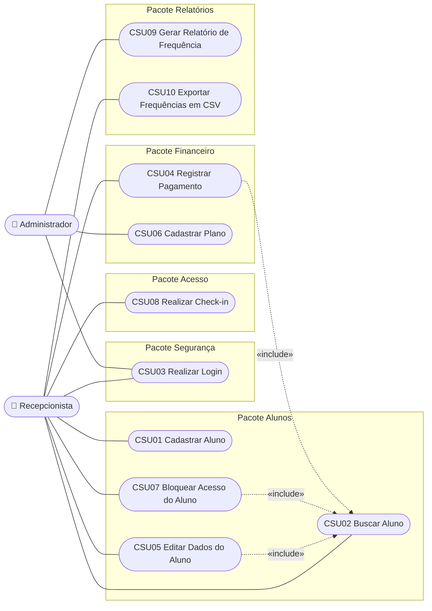

## 3.3.1 / 4.3.1 Diagrama de Classes (domínio)

Fonte: [`03-classes-dominio.mmd`](03-classes-dominio.mmd) · Imagem: [`img/03-classes-dominio.png`](img/03-classes-dominio.png)

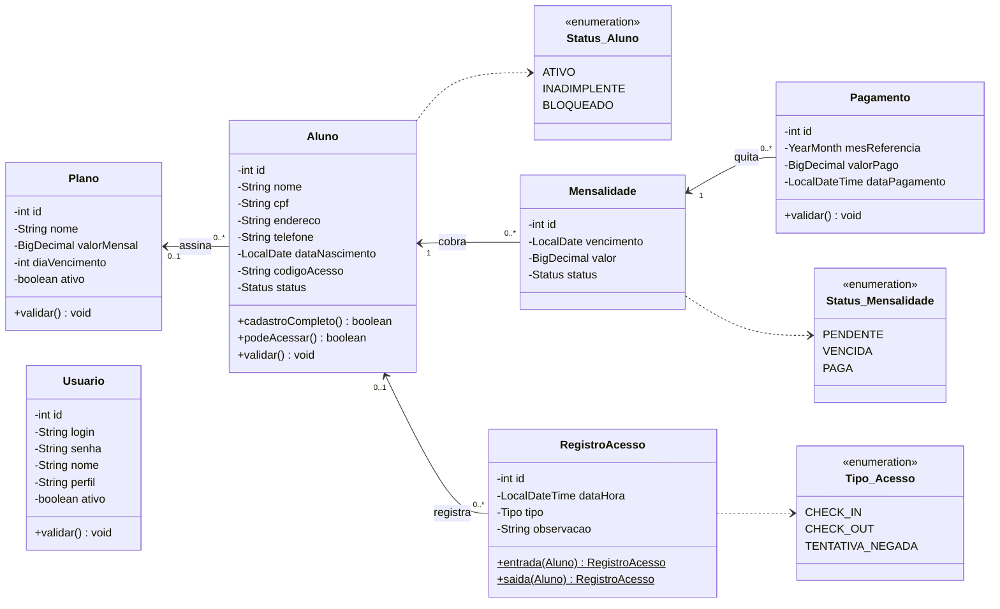

## 3.3.1 Análise de Robustez — CSU08 Realizar Check-in

Fonte: [`04-robustez-checkin.mmd`](04-robustez-checkin.mmd) · Imagem: [`img/04-robustez-checkin.png`](img/04-robustez-checkin.png)

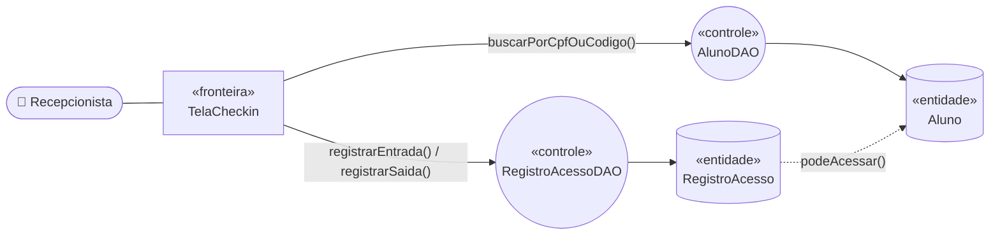

## 4.2.1 Diagrama de Sequência — CSU03 Realizar Login

Fonte: [`05-sequencia-login.mmd`](05-sequencia-login.mmd) · Imagem: [`img/05-sequencia-login.png`](img/05-sequencia-login.png)

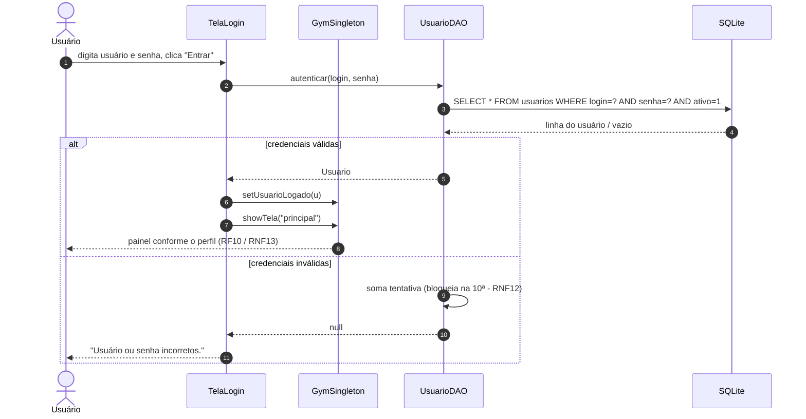

## 4.2.1 Diagrama de Sequência — CSU08 Realizar Check-in

Fonte: [`06-sequencia-checkin.mmd`](06-sequencia-checkin.mmd) · Imagem: [`img/06-sequencia-checkin.png`](img/06-sequencia-checkin.png)

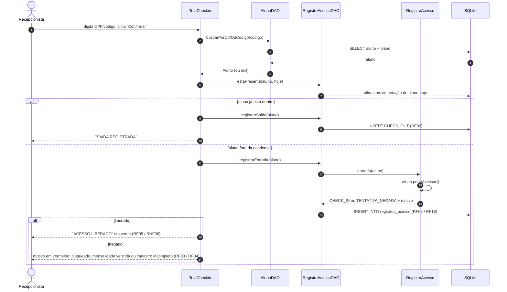

## 4.2.1 Diagrama de Sequência — CSU04 Registrar Pagamento

Fonte: [`07-sequencia-pagamento.mmd`](07-sequencia-pagamento.mmd) · Imagem: [`img/07-sequencia-pagamento.png`](img/07-sequencia-pagamento.png)

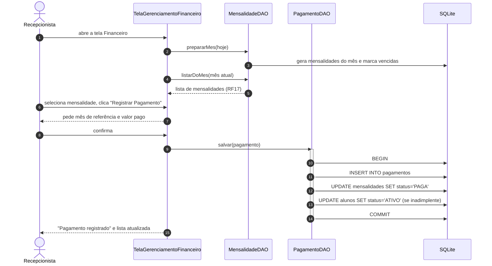

## 4.4.1 Diagrama de Transição de Estados — Aluno

Fonte: [`08-estados-aluno.mmd`](08-estados-aluno.mmd) · Imagem: [`img/08-estados-aluno.png`](img/08-estados-aluno.png)

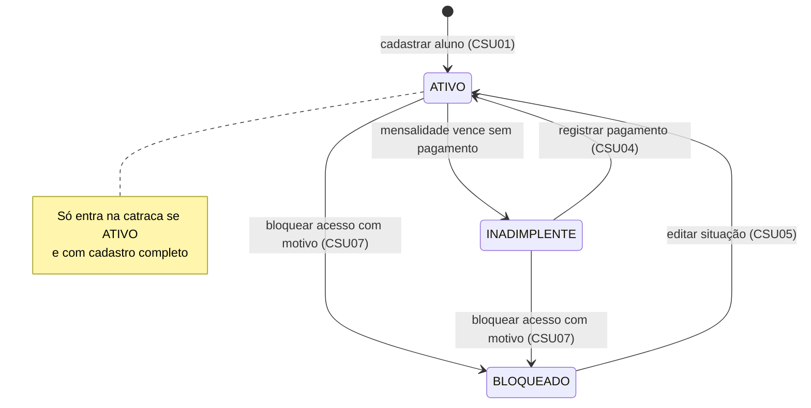

## 4.4.1 Diagrama de Transição de Estados — Mensalidade

Fonte: [`09-estados-mensalidade.mmd`](09-estados-mensalidade.mmd) · Imagem: [`img/09-estados-mensalidade.png`](img/09-estados-mensalidade.png)

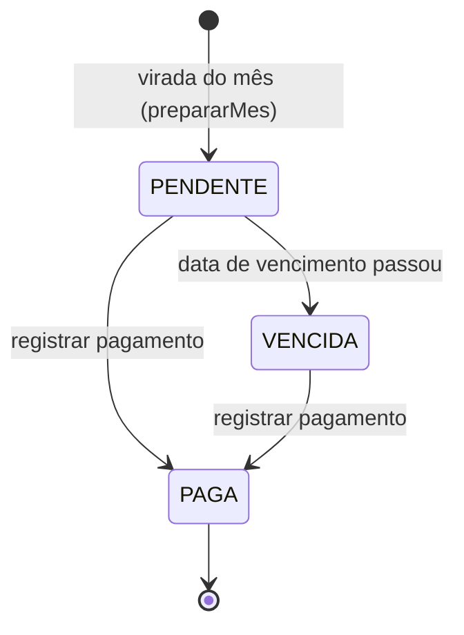

## 4.5.3 Diagrama de Atividades — validação da catraca

Fonte: [`10-atividade-checkin.mmd`](10-atividade-checkin.mmd) · Imagem: [`img/10-atividade-checkin.png`](img/10-atividade-checkin.png)

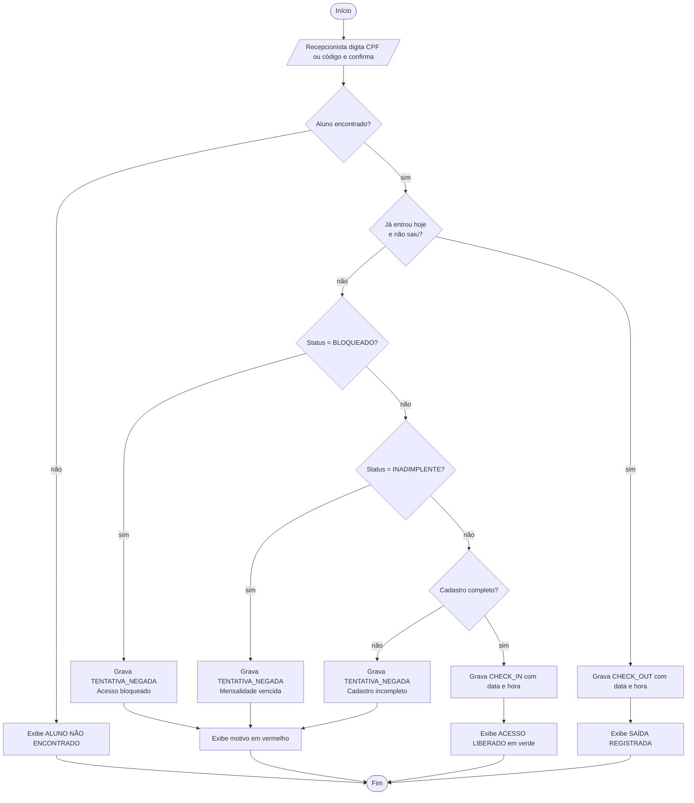

## 4.6.1 Diagrama de Pacotes

Fonte: [`11-pacotes.mmd`](11-pacotes.mmd) · Imagem: [`img/11-pacotes.png`](img/11-pacotes.png)

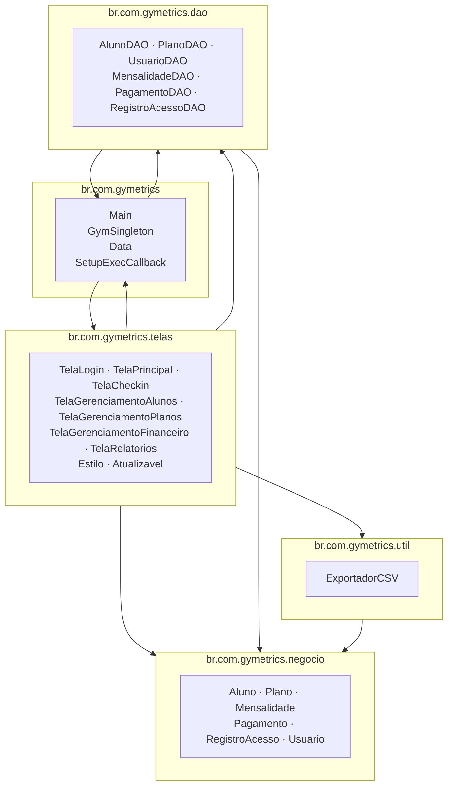

## 4.6.2 / 4.6.3 Diagrama de Componentes e Implantação

Fonte: [`12-implantacao.mmd`](12-implantacao.mmd) · Imagem: [`img/12-implantacao.png`](img/12-implantacao.png)

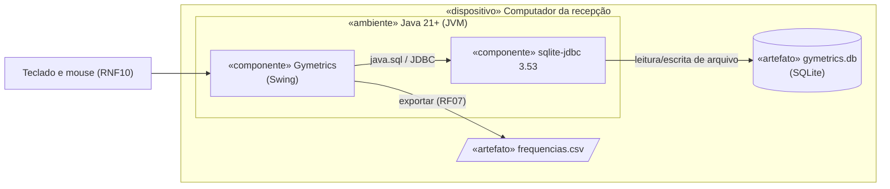

## 4.7.2 Modelo Relacional Normalizado (MRN)

Fonte: [`13-mrn.mmd`](13-mrn.mmd) · Imagem: [`img/13-mrn.png`](img/13-mrn.png)

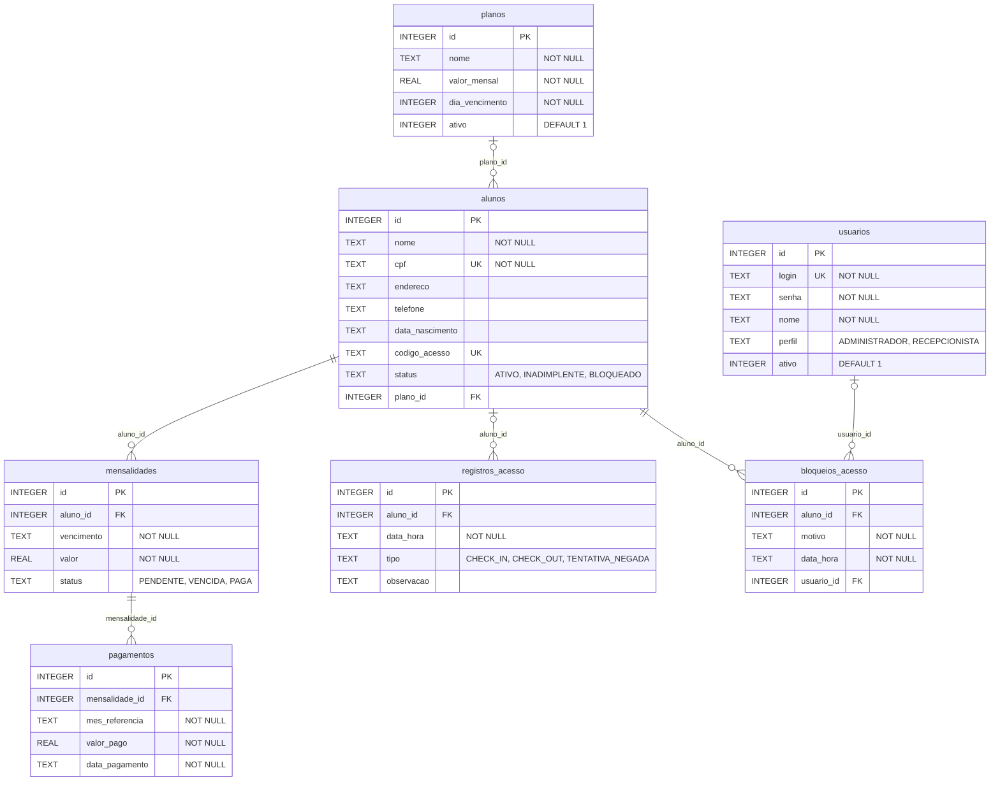

## 4.3.1 / 4.3.2 Diagrama de Classes completo (entidades, DAOs, utilitárias e telas)

Fonte: [`14-classes-sistema.mmd`](14-classes-sistema.mmd) · Imagem: [`img/14-classes-sistema.png`](img/14-classes-sistema.png)

```mermaid
%% 4.3.1 / 4.3.2 Diagrama de Classes completo (entidades, controle/DAO, utilitárias e fronteira)
%% Getters e setters das entidades foram omitidos para legibilidade.
classDiagram
    direction TB

    namespace gymetrics {
        class Main {
            +main(String[] args)$
        }
        class GymSingleton {
            <<singleton>>
            -GymSingleton instance$
            -CardLayout telasLayout
            -Map~String,Component~ porNome
            -Data data
            -Usuario usuarioLogado
            +getInstance()$ GymSingleton
            +showTela(String nome)
            +getUsuarioLogado() Usuario
            +setUsuarioLogado(Usuario u)
            +isAdmin() boolean
            +sair()
            +alunos() AlunoDAO
            +planos() PlanoDAO
            +usuarios() UsuarioDAO
            +pagamentos() PagamentoDAO
            +mensalidades() MensalidadeDAO
            +acessos() RegistroAcessoDAO
            +showMsg(String texto)
            +showErro(Exception e)
            +executar(Acao acao) boolean
            +takeFrame() JPanel
            -criarUsuariosIniciais()
        }
        class Data {
            -Connection mConnection
            +open(String arquivo)
            +exec(String sql, SetupExecCallback setup, RowMapper~T~ mapper) List~T~
            +insert(String sql, SetupExecCallback setup) int
            +update(String sql, SetupExecCallback setup) int
            +run(String sql)
            +transacao(SqlAction acao)
            +criarTabelas()
            +suicide()
        }
        class SetupExecCallback {
            <<interface>>
            +setupExecParams(PreparedStatement ps)
        }
    }

    namespace negocio {
        class Aluno {
            -int id
            -String nome
            -String cpf
            -String endereco
            -String telefone
            -LocalDate dataNascimento
            -String codigoAcesso
            -Status status
            -Plano plano
            +cadastroCompleto() boolean
            +podeAcessar() boolean
            +validar()
        }
        class Plano {
            -int id
            -String nome
            -BigDecimal valorMensal
            -int diaVencimento
            -boolean ativo
            +validar()
        }
        class Mensalidade {
            -int id
            -Aluno aluno
            -LocalDate vencimento
            -BigDecimal valor
            -Status status
        }
        class Pagamento {
            -int id
            -Mensalidade mensalidade
            -YearMonth mesReferencia
            -BigDecimal valorPago
            -LocalDateTime dataPagamento
            +validar()
        }
        class RegistroAcesso {
            -int id
            -Aluno aluno
            -LocalDateTime dataHora
            -Tipo tipo
            -String observacao
            +entrada(Aluno a)$ RegistroAcesso
            +saida(Aluno a)$ RegistroAcesso
        }
        class Usuario {
            -int id
            -String login
            -String senha
            -String nome
            -String perfil
            -boolean ativo
            +validar()
        }
    }

    namespace dao {
        class AlunoDAO {
            -Data db
            +salvar(Aluno a)
            +atualizar(Aluno a)
            +buscar(String termo) List~Aluno~
            +buscarPorCpfOuCodigo(String valor) Aluno
            +contar(Status status) int
            +bloquear(Aluno a, String motivo, Usuario responsavel)
        }
        class PlanoDAO {
            -Data db
            +salvar(Plano p)
            +atualizar(Plano p)
            +listar() List~Plano~
        }
        class MensalidadeDAO {
            -Data db
            +prepararMes(LocalDate hoje)
            +listarDoMes(YearMonth mes) List~Mensalidade~
            +vencendo(LocalDate hoje, int dias) List~Mensalidade~
        }
        class PagamentoDAO {
            -Data db
            +salvar(Pagamento p)
        }
        class RegistroAcessoDAO {
            -Data db
            +salvar(RegistroAcesso r)
            +registrarEntrada(Aluno a) RegistroAcesso
            +registrarSaida(Aluno a) RegistroAcesso
            +estaPresente(Aluno a, LocalDate dia) boolean
            +contarEntradas(LocalDate dia) int
            +contarPresentes(LocalDate dia) int
            +listarPorPeriodo(LocalDate inicio, LocalDate fim) List~RegistroAcesso~
        }
        class UsuarioDAO {
            -int MAX_TENTATIVAS$
            -Data db
            -Map~String,Integer~ tentativas
            +salvar(Usuario u)
            +contar() int
            +estaBloqueado(String login) boolean
            +autenticar(String login, String senha) Usuario
        }
    }

    namespace util {
        class ExportadorCSV {
            <<utility>>
            +exportarAcessos(List~RegistroAcesso~ lista, Path arquivo)$
        }
    }

    namespace telas {
        class Atualizavel {
            <<interface>>
            +atualizar()
        }
        class Estilo {
            <<utility>>
            +pagina()$ JPanel
            +cabecalho(String titulo, String subtitulo)$ JPanel
            +botao(String texto, Runnable acao)$ Botao
            +tabela(String... colunas)$ JTable
            +formulario(...)$ boolean
        }
        class TelaLogin {
            -entrar()
        }
        class TelaPrincipal
        class TelaCheckin {
            -confirmar()
        }
        class TelaGerenciamentoAlunos {
            -cadastrar()
            -editar()
            -bloquear()
        }
        class TelaGerenciamentoPlanos {
            -cadastrar()
            -editar()
            -alternar()
        }
        class TelaGerenciamentoFinanceiro {
            -registrarPagamento()
        }
        class TelaRelatorios {
            -gerar()
            -exportar()
        }
        class TelaDebug
    }

    %% associações entre entidades
    Aluno "0..*" --> "0..1" Plano : assina
    Mensalidade "0..*" --> "1" Aluno : cobra
    Pagamento "0..*" --> "1" Mensalidade : quita
    RegistroAcesso "0..*" --> "0..1" Aluno : registra

    %% infraestrutura
    Main ..> GymSingleton : getInstance()
    GymSingleton *-- Data
    GymSingleton *-- AlunoDAO
    GymSingleton *-- PlanoDAO
    GymSingleton *-- MensalidadeDAO
    GymSingleton *-- PagamentoDAO
    GymSingleton *-- RegistroAcessoDAO
    GymSingleton *-- UsuarioDAO
    GymSingleton --> Usuario : usuarioLogado
    GymSingleton o-- Atualizavel : telas
    Data ..> SetupExecCallback

    %% DAOs persistem as entidades (o uso de Data aparece no atributo -Data db)
    AlunoDAO ..> Aluno
    PlanoDAO ..> Plano
    MensalidadeDAO ..> Mensalidade
    PagamentoDAO ..> Pagamento
    RegistroAcessoDAO ..> RegistroAcesso
    UsuarioDAO ..> Usuario
    ExportadorCSV ..> RegistroAcesso

    %% telas
    Atualizavel <|.. TelaLogin
    Atualizavel <|.. TelaPrincipal
    Atualizavel <|.. TelaCheckin
    Atualizavel <|.. TelaGerenciamentoAlunos
    Atualizavel <|.. TelaGerenciamentoPlanos
    Atualizavel <|.. TelaGerenciamentoFinanceiro
    Atualizavel <|.. TelaRelatorios
    TelaRelatorios ..> ExportadorCSV
```
